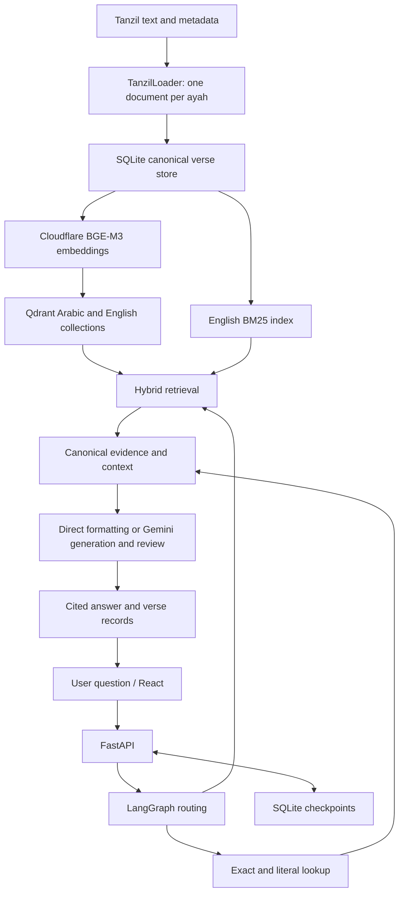

# Quran Lens

**Quran Lens** is a bilingual Quran research chatbot built with React, FastAPI, LangChain and LangGraph. It retrieves original Arabic verses and their Saheeh International English translation, then produces answers grounded in those records with verse citations.

The project uses a **traditional retrieval-augmented generation (RAG) system**: load documents, index them, retrieve evidence for a question, augment the model prompt with that evidence, and generate an answer. The model is not fine-tuned on the Quran. LangGraph coordinates a fixed `route → retrieve → generate` workflow.

Exact references, literal searches and counts also have a deterministic lookup path, so these operations do not depend on vector similarity or model-estimated counts.

## Features

- All 114 surahs and 6,236 numbered ayahs, with aligned Arabic and English text.
- Exact ayah, range and full-surah lookup.
- Literal Arabic/English word and phrase searches.
- Arabic lemma-based frequency counts using morphology annotations.
- Hybrid retrieval for themes, teachings and Quran narratives.
- Cited explanations and chapter summaries using canonical evidence.
- Neighboring ayahs for context in explicit verse explanations.
- Persistent chats with unique thread IDs, restoration, renaming and deletion.
- React frontend and server-sent events (SSE) for progress and answer delivery.

## Architecture



## 1. Dataset: where the documents came from

The Arabic text, English translation and surah metadata were downloaded from the **Tanzil Project**. Morphology comes from the **Quranic Arabic Corpus v0.4**, obtained through a CLTK mirror of the original download.

| File | Content | Source |
| --- | --- | --- |
| `data/quran-uthmani.txt` | Arabic Quran in Uthmani script | [Tanzil Quran text](https://tanzil.net/pub/download/index.php?quranType=uthmani&outType=txt-2&agree=true&marks=true&sajdah=true&tatweel=true) |
| `data/en.sahih.txt` | Saheeh International English translation | [Tanzil translation](https://tanzil.net/trans/?transID=en.sahih&type=txt-2) |
| `data/quran-data.xml` | Chapter names, numbers and verse counts | [Tanzil metadata](https://tanzil.net/res/text/metadata/quran-data.xml) |
| `data/morphology/quranic-corpus-morphology-0.4.txt` | Arabic morphology annotations | [Original corpus download page](https://corpus.quran.com/download/) |

`download.py` fetches the Tanzil files, rejects unexpected HTML, validates the aligned dataset and records URLs, download time, file sizes and SHA-256 hashes in `data/manifest.json`. Source files remain unchanged.

Read [data/ATTRIBUTION.md](data/ATTRIBUTION.md) for usage terms. Tanzil Quran text requires verbatim preservation and attribution. Translation download terms specify non-commercial use; commercial use requires permission from the translator or publisher. The morphology file retains its embedded copyright and license notices.

## 2. Document loader

`TanzilLoader` in `quran_rag/loader.py` extends LangChain's `BaseLoader` and produces LangChain `Document` objects.

It parses `surah|ayah|text` records, rejects duplicate keys, aligns Arabic and English by `surah:ayah`, and validates every expected key against the complete 114-surah metadata. Each document contains one ayah and its translation.

Metadata includes the verse key, chapter/ayah numbers, Arabic and English surah names, canonical Arabic text, translation, translation identity and source URL. Unnumbered opening formulas prepended to first ayahs are separated into `opening_header` metadata while the raw source stays unchanged.

## 3. Text splitter and chunking strategy

**There is no character-based text splitter in this project.** The loader performs natural segmentation into one complete numbered ayah per document.

This keeps verse boundaries intact and preserves accurate citations and bilingual alignment. Arbitrary character chunks would split canonical verses and complicate exact lookup.

When a question needs context, retrieval adds neighboring ayahs or connected passages at query time. Long chapter summaries use bounded source batches and representative evidence selection; the stored documents remain individual ayahs.

## 4. Canonical storage and vector indexing

`VerseStore` in `store.py` stores canonical records in `data/quran.sqlite`, keyed by chapter and ayah. A chapter/ayah index supports ordered range lookup. Canonical text returned to users comes from this store.

Ingestion builds two Qdrant collections:

- **English:** vectors of the English translations.
- **Arabic:** vectors of the numbered original Arabic ayahs.

A complete bilingual index has **6,236 vectors per language: 12,472 vectors total**. Qdrant payloads identify verses and record language/model/fingerprint information; SQLite supplies the full canonical records.

Model, engine and text fingerprints determine whether saved vectors can be reused. Indexing skips compatible records, processes pending ones in batches and resumes saved progress after interruption. Changing the embedding pipeline requires compatible reindexing, rather than assuming vectors from any provider are interchangeable.

## 5. Embedding model

The embedding model is **BAAI BGE-M3**, accessed through **Cloudflare Workers AI** with model identifier:

```text
@cf/baai/bge-m3
```

`CloudflareEmbeddings` implements LangChain's `Embeddings` interface. Both ingestion and runtime queries use this API. The adapter checks that returned vectors have 1,024 finite dimensions and applies bounded retries for temporary failures.

The application does not need local embedding weights or an embedding model loaded into RAM. For each hybrid search invocation, the query is embedded once and that vector searches both language collections. Expanded query variants can trigger additional search invocations.

## 6. Routing and SQLite-backed lookup retriever

`graph.py` first parses recognizable explicit requests deterministically. Other requests use an LLM-generated structured plan validated with Pydantic. `catalog.py` resolves surahs through all 114 chapters' metadata.

| Request | Retrieval operation | Example |
| --- | --- | --- |
| Exact ayah or range | Canonical ordered lookup | `Show me 2:255` |
| Chapter or subset | Chapter lookup | `Show the last verse of Surah Al-Baqarah` |
| Literal word/phrase | Exhaustive matching over stored text | `Find verses containing الذين آمنوا وعملوا الصالحات` |
| Frequency count | Arabic morphology or surface-token count | `How many times does forgiveness appear?` |
| Explicit explanation | Requested ayah and adjacent context | `Explain 2:55 in easy words` |
| Surah summary | Chapter records and bounded evidence processing | `Summarize Surah 1` |
| Theme or narrative | Hybrid semantic/lexical retrieval | `What does the Quran say about being kind to parents?` |

SQLite-backed lookup is not always a single SQL text-search statement. References and ranges use SQL; some literal operations scan normalized canonical records in Python; morphology counts use the corpus annotations.

### Word-frequency counting

Frequency questions count the **Arabic Quran**, not English translation occurrences. For English input, the model can resolve a complete word or expression to one Arabic dictionary lemma. The application validates that resolution and computes the count deterministically.

Lemma counts include annotated inflections and attached clitics of that lemma. They do not automatically combine every derived word sharing its root. Results distinguish occurrences from distinct verses. Explicit surface requests use written-token matching instead.

The LLM resolves meaning; it does not calculate or estimate the count. Genuinely ambiguous expressions may need clarification.

## 7. Hybrid retriever: BM25 + bilingual dense search + RRF

`HybridRetriever` combines three ranked lists:

1. **English BM25**, implemented with `rank_bm25.BM25Okapi`, for lexical matching against the translation.
2. **English dense retrieval**, using Qdrant cosine similarity over translation vectors.
3. **Arabic dense retrieval**, using the same multilingual query vector against Arabic vectors.

The results are merged with **reciprocal rank fusion (RRF)**:

```text
RRF score(verse) = sum(1 / (60 + rank))
```

Verses ranked well in several lists receive stronger combined scores. Results are deduplicated by verse key, and canonical records are fetched from SQLite.

The graph can expand questions into focused English search variants, combine rankings, assess relevance and select supporting evidence. Narrative queries can inspect wider canonical context and select connected ranges. These operations use the question and evidence rather than fixed passages for individual example stories.

There is no enabled dedicated cross-encoder reranker in the default path. Structured relevance and evidence assessments supplement retrieval but are distinct from a cross-encoder model.

Hybrid search is designed for relevant evidence, not guaranteed exhaustive coverage. Literal lists and frequency counts use the lookup path.

## 8. Augmentation: supplying evidence to the model

After retrieval, the system builds a prompt containing the question, canonical Arabic text, English translation, verse identifiers and relevant notices. Instructions constrain generation to the supplied evidence and permitted `[surah:ayah]` citations.

An explicit verse explanation adds one neighboring ayah on each side, clipped to the same surah. The explanation focuses on the requested ayah and cites neighbors when statements depend on them.

Surah summaries begin with canonical chapter records. Large chapters are processed in bounded sections with supporting canonical verse selection. `RAG_SOURCE_MAX_CHARS` controls the source budget. Intermediate selection prose is not treated as canonical Quran evidence.

This evidence-enriched prompt is the augmentation step in traditional RAG.

## 9. Generation model and evidence validation

The current local configuration selects **Google Gemini**, with **`gemini-3.5-flash-lite`** as the primary generation model. `GEMINI_MODEL` controls this choice. The committed `.env.example` provides configurable primary, fallback and review model settings; it does not contain credentials.

`provider.py` uses LangChain `ChatGoogleGenerativeAI` for Gemini, structured output, validation, bounded retries and fallbacks. It also retains Groq, Hugging Face and Cloudflare text adapters. The current setup uses Gemini generation and Cloudflare embeddings.

Explanatory answers are generated as structured statements with supporting verse IDs. The workflow checks allowed citations and quotations and uses a configured reviewer to assess claims against their cited evidence. Bounded corrections repair invalid evidence or unsupported drafts; unverified drafts are withheld.

Exact verse displays and literal results can be formatted directly from canonical records. A model may still participate in routing or expression translation, so a lookup request does not necessarily mean zero LLM calls.

Only Quran text and the stored translation supply answer evidence. The system does not retrieve scholarly tafsir or historical reports about occasions of revelation. It should abstain when the requested information is absent instead of supplementing it from model memory. These checks reduce errors but do not establish perfect accuracy.

## 10. Persistent chats and streaming

Every chat has a unique `thread_id`. LangGraph's `SqliteSaver` persists messages and state in `data/checkpoints.sqlite`. The backend lists unique threads from checkpoints, restores history using `graph.get_state`, updates titles through graph state and deletes chats using `delete_thread`.

**Persistence and follow-up interpretation are separate.** The current router treats each question independently and does not infer missing references from previous turns. Saved chats can be reopened, but an ambiguous follow-up such as `explain it` is not a supported reference-resolution feature. Use an explicit question such as `Explain 2:55 in easy words`.

`POST /chat/stream` sends SSE progress events during execution. Generated drafts are checked before the final answer is delivered through `answer_token` events. This streams a validated answer rather than exposing unreviewed generation tokens. Other events include `result`, `done` and `error`.

## Project components

| Component | Responsibility |
| --- | --- |
| `quran_rag/api.py` | FastAPI endpoints, SSE and checkpoint-based chat operations |
| `quran_rag/catalog.py` | Surah metadata and name resolution |
| `quran_rag/config.py` | Environment loading, paths and collection identities |
| `quran_rag/download.py` | Dataset download, validation and provenance |
| `quran_rag/loader.py` | Ayah-aligned LangChain document loading |
| `quran_rag/ingest.py` | Canonical ingestion and bilingual indexing |
| `quran_rag/embeddings.py` | Cloudflare BGE-M3 adapter |
| `quran_rag/retriever.py` | BM25, Qdrant search and bilingual RRF |
| `quran_rag/store.py` | Canonical lookup, literal matching and counts |
| `quran_rag/morphology.py` | Arabic corpus annotation handling |
| `quran_rag/graph.py` | Routing, augmentation, generation and review |
| `quran_rag/provider.py` | Model clients, structured output and fallbacks |
| `quran-rag-frontend/` | React interface built with Vite |
| `pyproject.toml` / `uv.lock` | Python dependencies and reproducible installation |

LangChain provides document/embedding interfaces, model integrations and structured-output utilities. LangGraph provides workflow execution and checkpoints. Quran-specific validation, morphology, routing and bilingual RRF remain application logic.

## Run locally

Requirements: Python 3.11+, `uv`, Node.js/npm, Cloudflare Workers AI credentials and a Gemini key with access to the configured models.

### Install and configure

From the project root in PowerShell:

```powershell
uv sync --locked
Copy-Item .env.example .env
```

Set `CLOUDFLARE_API_TOKEN`, `CLOUDFLARE_ACCOUNT_ID` and `GEMINI_API_KEY` in `.env`. Select `TEXT_GENERATION_PROVIDER=gemini`, choose an accessible `GEMINI_MODEL`, and configure generation/review fallbacks. Keep `EMBEDDING_MODEL=@cf/baai/bge-m3` for this embedding pipeline.

Model availability and quota depend on the account. Credentials belong only in the backend `.env`.

### Prepare the corpus and index

The source corpus is included. To download and validate the Tanzil files again:

```powershell
.venv/Scripts/python.exe -m quran_rag.download
```

Populate SQLite and both vector collections:

```powershell
.venv/Scripts/python.exe -m quran_rag.ingest --batch-size 32
```

Add `--sql-only` for canonical ingestion without embeddings. Hybrid queries require the complete bilingual index. Stop the API before indexing with local Qdrant: its storage cannot be opened by both processes simultaneously.

### Start the backend

```powershell
.venv/Scripts/python.exe -m uvicorn quran_rag.api:app --host 127.0.0.1 --port 8000
```

API documentation: <http://127.0.0.1:8000/docs>.

### Start the frontend

In another terminal:

```powershell
cd quran-rag-frontend
npm install
npm run dev
```

Open the Vite URL, usually <http://127.0.0.1:5173>. Vite proxies `/api` requests to port 8000. Build with `npm run build`.

## API endpoints

| Method | Endpoint | Purpose |
| --- | --- | --- |
| GET | `/health` | Corpus size, vector counts and readiness |
| GET | `/verses/{surah}/{ayah}` | Canonical verse |
| GET | `/search/word?word=patience` | English whole-word matches |
| GET | `/search/word/count?word=مغفرة` | Arabic count; optional `mode=surface` |
| POST | `/chat` | Answer and canonical evidence as JSON |
| POST | `/chat/stream` | SSE progress and validated answer delivery |
| GET / POST | `/conversations` | List threads or create a chat |
| GET / PATCH / DELETE | `/conversations/{key}` | Restore, rename or delete |

Example:

```powershell
$body = @{
    question = 'What does the Quran say about being kind to parents?'
    thread_id = 'my-chat'
} | ConvertTo-Json
Invoke-RestMethod http://127.0.0.1:8000/chat -Method Post -ContentType application/json -Body $body
```

Reuse the thread ID to save messages in one chat. A new ID creates separate state. Responses include answer text, canonical verse records, notices and applicable count or opening-header metadata.

## Storage and limitations

`data/quran.sqlite` contains canonical records, `data/qdrant/` contains local vectors and `data/checkpoints.sqlite` contains private chats. Generated databases/indexes, `.env`, virtual environments, `node_modules` and build output are ignored by Git. A fresh clone must create local indexes; back up checkpoints separately to preserve chats across migration.

`QDRANT_URL` optionally selects a Qdrant server. With local Qdrant, run one backend worker. A lock serializes graph requests. The current application has no authentication or per-user thread authorization; deployment needs appropriate access controls and production persistence.

Response time depends on embedding calls, retrieval breadth, generation and evidence review. Quotas and outages can interrupt requests. Semantic search is not exhaustive, explanations are not canonical Quran text, and the project does not provide scholarly tafsir. Evaluate answers against their cited verses rather than treating successful past tests as a guarantee for all future questions.
